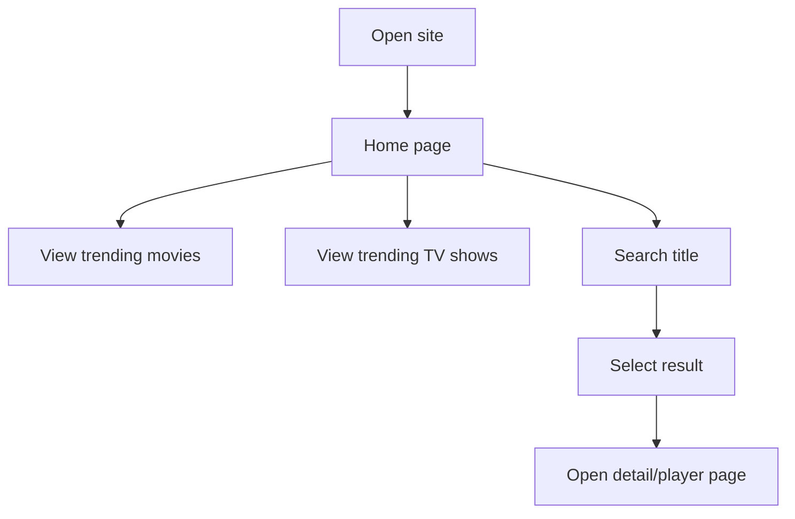
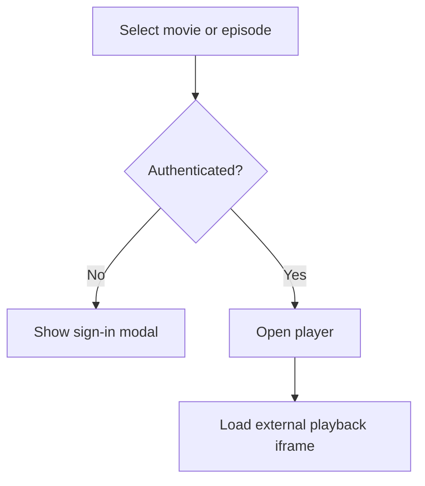
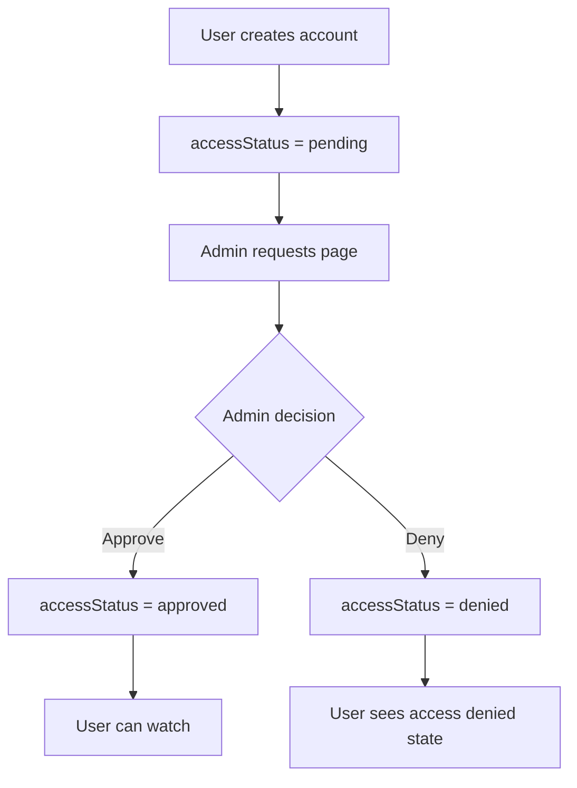
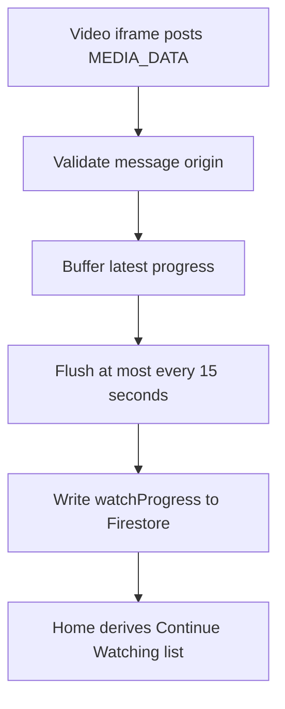
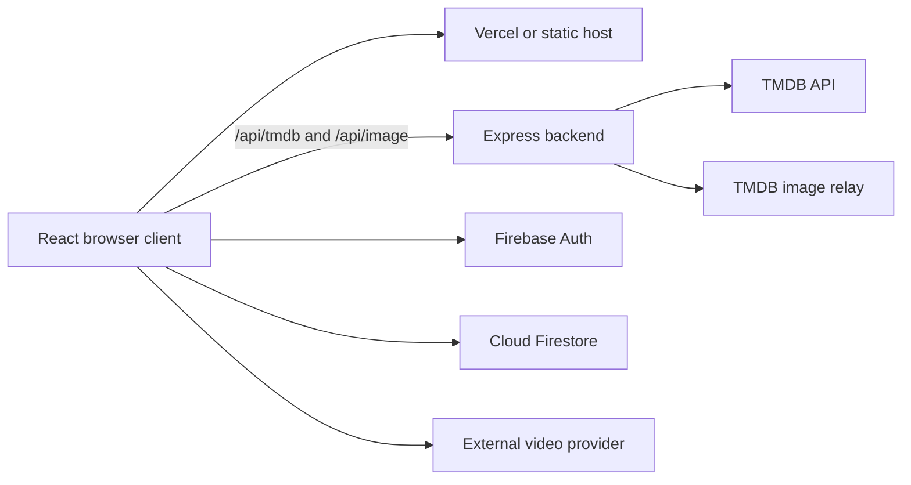

# A KYITE KYI
## System Requirements, UI Flows, Architecture, and Operations

**Document version:** 1.0  
**Last updated:** 2026-09-27  
**Repository:** `Ryanmrgo/A-KYITE-KYII`

---

## 1. Document Purpose

This document describes the current movie streaming application, its requirements, user flows, architecture, data contracts, deployment model, security boundaries, and recommended future improvements.

It is written as a combined:

- Software Requirements Specification (SRS)
- User and UI flow document
- Technical architecture document
- Operations and deployment guide
- Product limitations and roadmap

Sections marked **Planned** describe functionality that is not yet fully implemented.

---

## 2. Product Overview

A KYITE KYI is a responsive movie and TV discovery application. Users can:

- Browse trending movies and TV shows from TMDB.
- Search for movies and TV shows.
- View movie and TV metadata.
- Open an external video player.
- Create an account and sign in with Firebase Authentication.
- Save favorites to Firestore.
- Resume playback using synchronized watch progress.

The system is split into a Vite React frontend and a Node.js Express backend. The backend protects the TMDB API key from the browser.

### 2.1 Current access behavior

The current application supports account authentication, but movie playback is not yet fully enforced as a server-side authenticated capability. A future login-only or admin-approval flow must protect the player route and, for strong security, the playback authorization on the backend.

### 2.2 Important legal boundary

TMDB supplies metadata and artwork. It does not grant rights to stream movie or television content. The current external video iframe provider must be reviewed for licensing, availability, and commercial-use terms before public or paid distribution.

---

## 3. Scope

### 3.1 In scope

- Movie and TV discovery UI
- TMDB metadata proxy
- TMDB image routing
- Firebase email/password authentication
- Firestore favorites
- Firestore watch progress
- Movie and TV detail/player pages
- Responsive desktop and mobile layouts
- Vercel, Render, Docker, and AWS deployment support

### 3.2 Out of scope

- Owning or storing movie video content
- Content licensing management
- Payments or subscriptions
- Recommendation machine learning
- Native mobile applications
- Guaranteed playback availability in every country
- Full DRM or signed-video authorization from the current external player

---

## 4. Actors and Roles

| Actor | Description |
|---|---|
| Visitor | Unauthenticated user browsing public content. |
| Registered user | Firebase-authenticated user who can use account features. |
| Approved user | **Planned** user whose viewing request has been accepted. |
| Administrator | **Planned** trusted operator who approves or denies access requests. |
| TMDB | External provider for movie and TV metadata and image paths. |
| Firebase | External provider for authentication and Firestore profile data. |
| Video provider | External provider embedded by the movie and TV player pages. |

---

## 5. Functional Requirements

### FR-001 Application access

The system shall load a responsive home page at `/`.

### FR-002 Trending content

The system shall show trending movies and TV shows using TMDB trending endpoints.

### FR-003 Search

The system shall search TMDB multi-search results and show only movie and TV records, excluding people.

### FR-004 Movie details

The system shall show movie title, poster, overview, rating, runtime, genres, credits, and related metadata when returned by TMDB.

### FR-005 TV details

The system shall show TV show metadata, seasons, episodes, episode stills, and episode selection.

### FR-006 Image delivery

The system shall convert TMDB image paths into backend image URLs and preserve the correct artwork for each record.

### FR-007 Authentication

Users shall be able to create an account, sign in, and sign out using Firebase email/password authentication.

### FR-008 User profile

The system shall store user profile data in Firestore under `users/{uid}`.

### FR-009 Favorites

Authenticated users shall be able to save and remove movies and TV shows from Favorites.

### FR-010 Watch progress

The system shall receive validated playback messages from approved Vidfast origins and throttle progress writes to Firestore.

### FR-011 Continue Watching

The system shall show incomplete watch items sorted by most recent progress and exclude items at or above 95 percent completion.

### FR-012 Health monitoring

The backend shall provide `/health` and report whether the TMDB API key is configured.

### FR-013 Login-only playback - Planned

The system shall require an authenticated Firebase user before opening a movie or TV player.

### FR-014 Admin approval - Planned

The system shall allow an administrator to approve, deny, suspend, and review viewing access requests.

### FR-015 Server-side playback authorization - Planned

The backend shall verify Firebase ID tokens before issuing playback authorization. Frontend-only checks are not sufficient to protect a direct external iframe URL.

---

## 6. Non-Functional Requirements

### NFR-001 Security

- TMDB API keys shall remain server-side.
- Environment files shall never be committed.
- Firebase Firestore rules shall prevent users from changing their own role or approval status.
- The backend shall restrict CORS to configured origins.
- External messages shall be accepted only from known video-provider origins.
- Electron or future desktop builds shall disable renderer Node integration.

### NFR-002 Availability

The backend shall expose a health endpoint for Render, Docker, or EC2 monitoring.

### NFR-003 Performance

TMDB requests shall use a timeout. Future production deployments should add caching and rate limiting.

### NFR-004 Responsiveness

The frontend shall support desktop and mobile viewports with horizontally scrollable content rows and responsive player layouts.

### NFR-005 Maintainability

Frontend API access shall remain centralized in `frontend/src/hooks/useTmdb.js`. Backend configuration shall use environment variables and small route responsibilities.

### NFR-006 Privacy

The application shall avoid collecting unnecessary personal information. Firebase and Firestore usage shall be documented in the privacy policy before public launch.

---

## 7. UI and User Flows

### 7.1 Visitor browsing flow



### 7.2 Authentication flow

```mermaid
flowchart TD
    A[Visitor selects Sign In] --> B[Auth modal]
    B --> C{Existing account?}
    C -->|Yes| D[Firebase signInWithEmailAndPassword]
    C -->|No| E[Firebase createUserWithEmailAndPassword]
    E --> F[Create users/{uid} profile]
    D --> G[Auth state listener updates UI]
    F --> G
    G --> H[Navbar shows authenticated state]
```

### 7.3 Login-only playback flow - Planned



### 7.4 Admin approval flow - Planned



### 7.5 Favorites flow

```mermaid
flowchart TD
    A[Authenticated user opens title] --> B[Select Add to Favorites]
    B --> C[Firestore update users/{uid}]
    C --> D[Favorite appears on Favorites page]
    D --> E[Select Remove]
    E --> F[Firestore updates favorites array]
```

### 7.6 Continue Watching flow



---

## 8. System Architecture



### 8.1 Frontend layers

```text
frontend/src/
├── main.jsx                 Application bootstrap
├── App.jsx                  Router and global providers
├── components/              Reusable UI components
├── contexts/                Shared authentication state
├── data/                    Local demo/static content
├── hooks/                   TMDB and playback-progress logic
└── pages/                   Home, Favorites, MoviePlayer, TvPlayer
```

### 8.2 Backend layers

```text
backend/
├── server.js                Express server and API routes
├── package.json             Runtime dependencies and start script
├── Dockerfile               Backend container definition
└── .env                     Local-only secrets and port settings
```

### 8.3 Request flow

```text
React hook
  -> VITE_API_URL/api/tmdb/...
  -> Express backend
  -> TMDB API with private key
  -> Express response
  -> React state
  -> UI component
```

### 8.4 Image flow

```text
TMDB poster_path
  -> /api/image/{size}/{filename}
  -> backend validates image path
  -> backend redirects through configured image relay
  -> browser displays returned artwork
```

---

## 9. Application Routes

| Route | Component | Purpose | Current access |
|---|---|---|---|
| `/` | `Home` | Main discovery page | Public |
| `/movies` | `Home` | Movie discovery alias | Public |
| `/tv` | `Home` | TV discovery alias | Public |
| `/movie/:id` | `MoviePlayer` | Movie metadata and playback | Public UI route; login gate planned |
| `/tv/:id` | `TvPlayer` | TV metadata, seasons, episodes, playback | Public UI route; login gate planned |
| `/favorites` | `Favorites` | Saved user titles | Authenticated UI |
| `/admin` | Not implemented | Admin operations | Planned |

---

## 10. Backend API Contract

### `GET /`

Returns a basic service identity response.

```json
{
  "name": "movie-backend",
  "status": "ok"
}
```

### `GET /health`

Returns service health and TMDB configuration status.

```json
{
  "status": "ok",
  "tmdbConfigured": true
}
```

### `GET /api/tmdb/*`

Proxies supported TMDB read requests. Examples:

```text
/api/tmdb/trending/movie/week
/api/tmdb/trending/tv/week
/api/tmdb/movie/{id}?append_to_response=credits,videos
/api/tmdb/tv/{id}?append_to_response=credits
/api/tmdb/search/multi?query=...
```

### `GET /api/image/*`

Validates a TMDB image path and redirects to the image relay.

### Planned response codes

| Code | Meaning |
|---|---|
| 200 | Successful request |
| 400 | Invalid endpoint or image path |
| 401 | Missing or invalid authentication token - planned |
| 403 | User is not approved - planned |
| 502 | Upstream TMDB failure |
| 503 | TMDB key not configured |
| 504 | Upstream timeout |

---

## 11. Data Model

### 11.1 Firestore user document

```text
users/{uid}
```

Current fields may include:

```json
{
  "email": "user@example.com",
  "name": "User Name",
  "createdAt": "ISO-8601 timestamp",
  "favorites": [],
  "watchProgress": {}
}
```

Recommended future fields:

```json
{
  "role": "user",
  "accessStatus": "pending",
  "approvedAt": null,
  "approvedBy": null,
  "denialReason": null
}
```

### 11.2 Favorites item

```json
{
  "id": 12345,
  "title": "Example title",
  "type": "movie",
  "poster_path": "/example.jpg",
  "addedAt": "ISO-8601 timestamp"
}
```

### 11.3 Watch progress

Movie keys use the form:

```text
m{movieId}
```

TV keys use the form:

```text
t{seriesId}
```

A progress record contains provider data such as:

```json
{
  "progress": {
    "watched": 120,
    "duration": 7200
  },
  "last_updated": 1720000000000,
  "last_season_watched": 1,
  "last_episode_watched": 4
}
```

---

## 12. Security Design

### Current protections

- TMDB API key is backend-only.
- `.env` files are ignored by Git.
- Backend uses request timeouts.
- CORS is restricted to configured origins.
- Image paths are validated.
- Vidfast `postMessage` origins are allowlisted.
- Firebase is initialized only when configuration exists.
- Firebase listeners are cleaned up on unmount.

### Required before public launch

- Rotate any API key exposed in chat, logs, or Git history.
- Add Firestore security rules.
- Restrict Firebase API key usage by domain in Google Cloud.
- Add a login gate to player routes.
- Add server-side Firebase token verification for protected playback.
- Add rate limiting to TMDB proxy routes.
- Add caching for trending and search responses.
- Add abuse monitoring and structured logs.
- Confirm the external video provider's legal and commercial terms.

### Login-only versus approval-only access

| Policy | Requirement to watch |
|---|---|
| Public | No account required |
| Login-only | Valid Firebase account required |
| Approval-only | Admin-approved account required |
| Login plus approval | Valid account and `accessStatus = approved` |

For the requested controlled-access model, use login plus approval.

---

## 13. Deployment Architecture

### Recommended deployment

```text
Vercel
  frontend build from frontend/

Render
  Node backend from backend/ or root Dockerfile

Firebase
  Authentication and Firestore

TMDB
  Metadata API
```

### Frontend environment variables

```env
VITE_API_URL=https://your-backend.onrender.com
VITE_FIREBASE_API_KEY=...
VITE_FIREBASE_AUTH_DOMAIN=...
VITE_FIREBASE_PROJECT_ID=...
VITE_FIREBASE_STORAGE_BUCKET=...
VITE_FIREBASE_MESSAGING_SENDER_ID=...
VITE_FIREBASE_APP_ID=...
```

### Backend environment variables

```env
PORT=5000
TMDB_API_KEY=...
CORS_ORIGIN=https://your-frontend.vercel.app
```

### Docker

The root `Dockerfile` packages the backend for hosts that build from the repository root. The backend Dockerfile packages the backend when `backend/` is used as the build context.

Root build:

```powershell
docker build -t movie-backend .
```

Root run:

```powershell
docker run --rm -p 5000:5000 --env-file .\backend\.env movie-backend
```

### CI/CD

GitHub Actions workflows currently support:

- Frontend build and deployment to AWS S3/CloudFront.
- Backend Docker build and deployment to AWS EC2.

The Render/Vercel flow can be triggered from the hosting dashboards using `render.yaml` and `frontend/vercel.json`.

---

## 14. Local Development

Run backend from the repository root:

```powershell
npm --prefix backend start
```

Run frontend from the repository root:

```powershell
npm --prefix frontend run dev
```

The repository root is:

```text
D:\movie-app\movie_stream_site
```

Running `npm --prefix backend start` from `D:\movie-app` fails because `backend/package.json` is inside `movie_stream_site`.

### Local URLs

```text
Frontend: http://localhost:5173
Backend:  http://localhost:5000
Health:   http://localhost:5000/health
```

---

## 15. Quality and Testing Strategy

### Current checks

```powershell
npm --prefix frontend run lint
npm --prefix frontend run build
node --check backend/server.js
```

### Recommended tests

- Unit tests for TMDB URL builders.
- Hook tests for loading, error, abort, and stale-request behavior.
- Firestore rule tests for favorites and approval status.
- API tests for `/health`, invalid TMDB paths, CORS, and image validation.
- Browser tests for login, favorites, player navigation, and responsive layout.
- Deployment smoke test against `/health` and one TMDB endpoint.
- Load tests for concurrent trending requests and Firestore progress writes.

### Acceptance criteria

A release is acceptable when:

- Frontend lint succeeds.
- Frontend production build succeeds.
- Backend syntax and startup succeed.
- `/health` returns `status: ok`.
- TMDB requests return data without exposing the API key.
- Posters match the returned TMDB `poster_path`.
- Firebase login, logout, favorites, and progress behavior work.
- Production frontend points to the deployed backend, not localhost.
- CORS accepts the deployed frontend origin.

---

## 16. Known Risks and Limitations

1. The external video provider may be blocked or unavailable in some countries.
2. The external video provider may not support strong access control.
3. TMDB and image-relay availability affect discovery and posters.
4. A single backend instance is not designed for large traffic spikes.
5. Firestore writes must remain throttled to control cost and quota usage.
6. The frontend bundle contains Firebase web configuration by design; restrict the associated key by domain.
7. Commercial use requires reviewing TMDB terms, video licensing, and copyright obligations.
8. The current deployment workflows contain separate AWS and Render/Vercel paths; choose one primary production path to reduce operational complexity.

---

## 17. Future Roadmap

### Phase 1: Controlled access

- Add login-only player route guards.
- Add `accessStatus` to user profiles.
- Add admin request review page.
- Add Firestore security rules.

### Phase 2: Backend authorization

- Verify Firebase ID tokens in Express.
- Add protected playback authorization endpoint.
- Replace direct external iframe URLs where possible with signed playback URLs.

### Phase 3: Reliability

- Add TMDB response caching.
- Add rate limiting.
- Add centralized error monitoring.
- Add automated API and browser tests.
- Add graceful shutdown and structured logging.

### Phase 4: Scale and compliance

- Use a managed database strategy for higher traffic.
- Add CDN caching for public metadata and images.
- Obtain required content and API permissions.
- Add privacy policy, terms of service, and account deletion flow.

---

## 18. Glossary

| Term | Meaning |
|---|---|
| TMDB | The Movie Database, used for movie and TV metadata. |
| Vite | Frontend development server and production bundler. |
| Firebase Auth | Authentication service used for user accounts. |
| Firestore | Firebase document database used for profiles, favorites, and progress. |
| CORS | Browser policy controlling which origins can call the backend. |
| Vidfast | External embedded video provider currently used by player pages. |
| Render | Hosting option for the Express backend. |
| Vercel | Hosting option for the Vite frontend. |
| SRS | Software Requirements Specification. |
