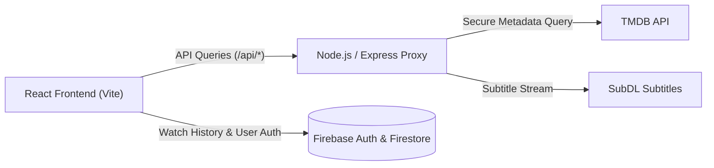

# 🎬 A-KYITE-KYII (Movie Streamer)

[](https://react.dev/)
[](https://vitejs.dev/)
[](https://nodejs.org/)
[](https://firebase.google.com/)
[](https://www.docker.com/)
[](LICENSE)

**A-KYITE-KYII** is a high-performance, full-stack streaming media platform. It features synchronized cross-device watch history, personalized watchlists, automated subtitle fetching, and a decoupled security proxy that shields third-party API credentials from public exposure.

---

## 🌟 Key Features

- **Real-Time Cross-Device Watch Progress**: Automatically persists playback timestamps across sessions using Firebase Firestore real-time listeners.
- **Dynamic Content Discovery**: Live Trending & Top 10 rankings for Movies and TV shows powered by TMDB integration.
- **Automated Subtitle Support**: Subtitle search, caching, and dynamic overlay rendering powered by the SubDL API.
- **Secure Backend Proxy Architecture**: External media API tokens never leak to the client; all queries are routed through an Express proxy with CORS validation.
- **Multi-Cloud Ready**: Deployment-ready with Docker containers, Render Blueprint (`render.yaml`), Vercel client rules (`vercel.json`), or AWS (S3 + CloudFront + EC2).

---

## 🏗️ Architecture Overview



---

## 📁 Project Structure

```plaintext
movie_stream_site/
├── backend/                  # Node.js + Express API Proxy
│   ├── server.js             # Route proxies, rate limits, SubDL & TMDB integration
│   ├── .env.example          # Environment variables template
│   └── package.json
├── frontend/                 # Vite + React Client Application
│   ├── src/
│   │   ├── components/       # UI Components (Navbar, Cards, SubtitleOverlay)
│   │   ├── hooks/            # Custom hooks (useSubtitles, useWatchProgress)
│   │   ├── pages/            # MoviePlayer, TvPlayer, Home, Browse, Watchlist
│   │   └── firebase.js       # Firebase SDK initialization
│   ├── .env.example          # Client environment template
│   └── package.json
├── Dockerfile                # Production container configuration
├── render.yaml               # Infrastructure-as-code for Render deployment
└── PROJECT_DOCUMENTATION.md  # Deep dive architecture and deployment specs
```

---

## 🚀 Local Development Setup

### Prerequisites
- **Node.js** (v18 or higher)
- **Firebase Account** (Firestore + Auth enabled)
- **TMDB API Key** (Free from [themoviedb.org](https://www.themoviedb.org/))
- **SubDL API Key** (Optional, for live subtitles)

### 1. Clone the repository
```bash
git clone https://github.com/Ryanmrgo/A-KYITE-KYII.git
cd A-KYITE-KYII
```

### 2. Configure Environment Variables

**Backend (`backend/.env`):**
```bash
cp backend/.env.example backend/.env
```
Fill in:
```env
PORT=5000
TMDB_API_KEY=your_tmdb_api_key
SUBDL_API_KEY=your_subdl_key
CORS_ORIGIN=http://localhost:5173
```

**Frontend (`frontend/.env`):**
```bash
cp frontend/.env.example frontend/.env
```
Fill in your Firebase credentials:
```env
VITE_API_URL=http://localhost:5000
VITE_FIREBASE_API_KEY=your_firebase_api_key
VITE_FIREBASE_AUTH_DOMAIN=your_project.firebaseapp.com
VITE_FIREBASE_PROJECT_ID=your_project_id
VITE_FIREBASE_STORAGE_BUCKET=your_project.firebasestorage.app
VITE_FIREBASE_MESSAGING_SENDER_ID=your_sender_id
VITE_FIREBASE_APP_ID=your_app_id
```

### 3. Install & Run
```bash
# Install all dependencies
npm install
npm run install-all

# Start both backend and frontend concurrently
npm run dev
```

Visit `http://localhost:5173` to explore the application.

---

## 🧪 Technical Interview Talking Points

- **API Key Security**: Explaining why client-side single-page applications (SPAs) should never hold secret third-party tokens, and how the Express proxy acts as a secure buffer.
- **State Hydration & Resiliency**: Handling playback interruptions and syncing progress to Firestore without overloading write operations.
- **Containerization**: Writing multi-stage Docker builds to ensure consistent runtime behavior across local machines, Render, and AWS EC2.

---

## 👨‍💻 Author

**Sanda Pyae Sone (Ryan)**  
- GitHub: [@Ryanmrgo](https://github.com/Ryanmrgo)  
- Focus: Full-Stack Web Development, Agentic AI, and Applied Machine Learning  
- Institution: Myanmar Institute of Information Technology (MIIT)

---

## 📄 License

Distributed under the [MIT License](LICENSE).
