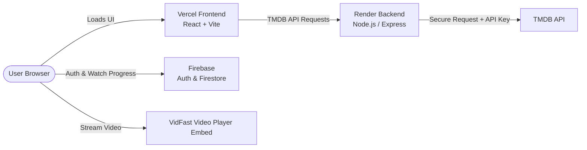

# A-KYITE-KYII — Full-Stack Movie & TV Streaming Platform

[](https://vercel.com)
[](https://render.com)
[](https://hub.docker.com)
[](https://firebase.google.com)

A modern, full-stack video streaming web application featuring real-time watch progress synchronization, user authentication, and seamless movie and TV series playback with a sleek dark-mode UI.

---

## 🌟 Core Features

- **High-Definition Video Streaming**: Seamless playback for movies and television series powered by VidFast embed technology.
- **Real-Time Watch Progress Synchronization**: Listens to player events and saves exact timestamps and percentages directly to Cloud Firestore, enabling instant resume playback from where you left off across any device.
- **TV Series Season & Episode Navigator**: Intuitive episode selector with episode-level progress tracking and automated next-episode transitions.
- **Personalized User Profiles**: Email/password and Google authentication via Firebase, complete with cloud-synced **Favorites** and **Continue Watching** rows.
- **Trending & Top Ranked Content**: Real-time weekly trending media, genres, and top-rated categories dynamically populated from The Movie Database (TMDB).
- **Secure Backend API Proxy**: All TMDB metadata and image requests route through a dedicated Node.js/Express proxy, preventing exposure of sensitive API keys to the client.

---

## 🚀 Roadmap & Planned Enhancements

### 1. Multi-Server / Backup Video Sources *(Priority #1)*
* **Current Implementation**: Streaming is powered by the VidFast embed engine (`https://vidfast.pro`).
* **Planned Upgrade**: An integrated multi-server switcher dropdown on the video player allowing users to toggle between redundant providers (e.g., **Server 1: VidFast**, **Server 2: SuperEmbed**, **Server 3: VidLink/vidsrc**). If a stream experiences buffering or regional downtime, users can swap streams with one click without losing their place.

### 2. Instant Search & Live Suggestions
* Real-time search modal in the navigation bar with debounced TMDB multi-search query resolving movies, series, and cast members as you type.

### 3. Integrated Subtitles & Audio Tracks
* Multi-language subtitle toggle supporting custom `.vtt` and `.srt` caption tracks and automatic synchronization.

### 4. Progressive Web App (PWA) Mobile Support
* Web manifest and service worker configuration allowing users to install the platform as a standalone native-feeling app on iOS and Android.

### 5. Community Reviews & Episode Discussions
* Discussion boards and ratings under each title powered by Firestore to encourage community interaction.

---

## 🛠️ Technology Stack

| Layer | Technologies |
| :--- | :--- |
| **Frontend** | React 18, Vite, React Router v6, Tailwind CSS, Lucide Icons |
| **Backend** | Node.js, Express, Axios, CORS, Docker |
| **Auth & Database** | Firebase Authentication, Cloud Firestore |
| **Video Engine** | VidFast Embed API (`vidfast.pro`) |
| **Metadata Provider** | The Movie Database (TMDB) API |
| **Hosting & CI/CD** | Vercel (Frontend), Render (Backend), Docker Hub, GitHub Actions |

---

## 🏗️ Architecture & Deployment



- **Frontend Deployment (Vercel)**: Automatically builds and serves the single-page React app upon pushes to `main`.
- **Backend Deployment (Render)**: Deploys the Node.js proxy service using [`render.yaml`](./render.yaml) with automatic health check monitoring at `/health`.
- **CI/CD Pipeline (GitHub Actions)**: Containerizes the backend via Docker and pushes verified images to Docker Hub on every backend change.

---

## 💻 Local Development Setup

### Prerequisites
- [Node.js](https://nodejs.org/) (v18 or higher)
- [Git](https://git-scm.com/)
- A free [TMDB Account & API Key](https://www.themoviedb.org/settings/api)
- A [Firebase Project](https://console.firebase.google.com/) with Authentication & Firestore enabled

### 1. Clone the Repository
```bash
git clone https://github.com/Ryanmrgo/A-KYITE-KYII.git
cd A-KYITE-KYII
```

### 2. Configure Environment Variables

#### Backend (`backend/.env`)
```env
PORT=5000
TMDB_API_KEY=your_tmdb_api_key_here
CORS_ORIGIN=http://localhost:5173
```

#### Frontend (`frontend/.env`)
```env
VITE_API_URL=http://localhost:5000
VITE_FIREBASE_API_KEY=your_firebase_api_key
VITE_FIREBASE_AUTH_DOMAIN=your_project.firebaseapp.com
VITE_FIREBASE_PROJECT_ID=your_project_id
VITE_FIREBASE_STORAGE_BUCKET=your_project.appspot.com
VITE_FIREBASE_MESSAGING_SENDER_ID=your_messaging_id
VITE_FIREBASE_APP_ID=your_app_id
```

### 3. Install Dependencies & Run

Install dependencies for both projects:
```bash
cd backend && npm install
cd ../frontend && npm install
```

Start the local development servers:
```bash
# Terminal 1 - Backend (runs on port 5000)
cd backend && npm start

# Terminal 2 - Frontend (runs on port 5173)
cd frontend && npm run dev
```

---

## 🚢 Production Deployment

### Backend to Render
1. In Render, select **New > Blueprint** and link your GitHub repository.
2. Render will automatically detect [`render.yaml`](./render.yaml).
3. Set the environment variables in Render:
   - `TMDB_API_KEY`: Your TMDB API key.
   - `CORS_ORIGIN`: Your production frontend URL (e.g. `https://your-app.vercel.app`).

### Frontend to Vercel
1. In Vercel, import your repository.
2. Select `frontend` as the **Root Directory**.
3. Add the required `VITE_FIREBASE_*` and `VITE_API_URL` environment variables pointing to your Render backend URL.
4. Deploy!

---

## 📄 License
This project is open-source and distributed under the [MIT License](LICENSE).
